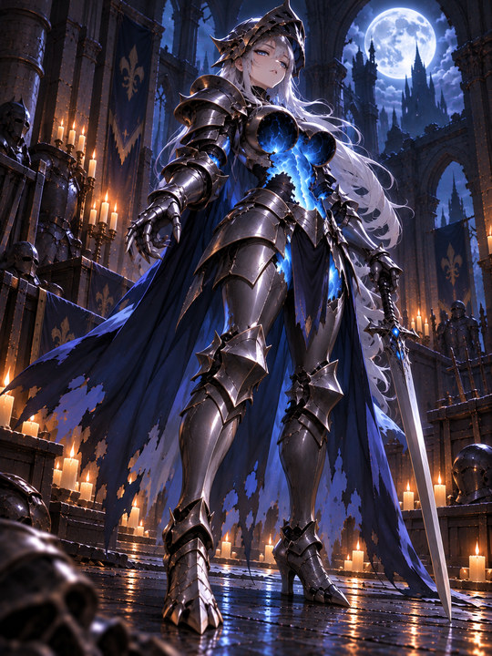
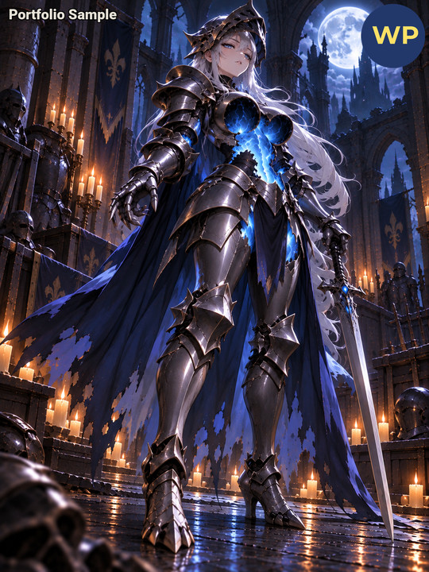
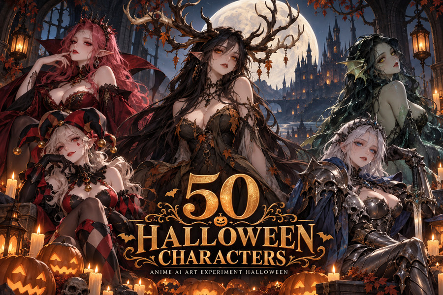
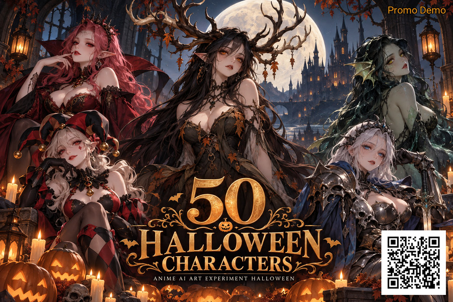
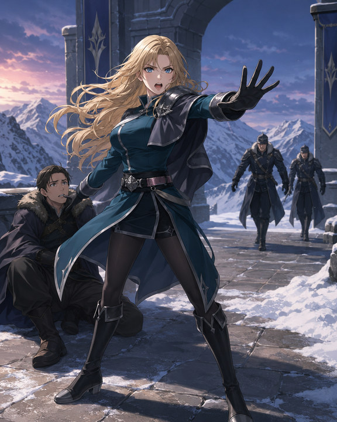
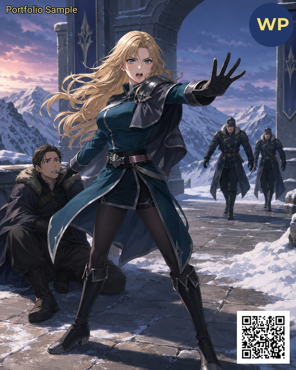

# WatermarkPro — Before & After Examples

[← Back to WatermarkPro](README.md) · [Product walkthrough](PRODUCT_TOUR.md) · [Testing evidence](TESTING.md)

These pairs use **real images processed through WatermarkPro**. The **Before** images are the input artworks; the **After** images are previews of actual WatermarkPro PNG outputs. They were resized and compressed for this public portfolio, so the full-resolution unwatermarked originals and full-resolution exports are **not** being distributed here.

> **What these examples demonstrate:** Applying visible text, logo, and QR watermark elements across portrait artwork and a promotional poster. This page showcases user-facing results; it is not a claim of copy-proof protection, automated ownership verification, or universal compatibility.

---

## 1. Armored knight — Minimal branding on digital artwork

A dark fantasy portrait demonstrating watermark text and a visible logo badge on a single-subject illustration.

<table>
<tr><th width="50%">Before · Original artwork</th><th width="50%">After · WatermarkPro output</th></tr>
<tr><td align="center"></td><td align="center"></td></tr>
</table>

**Features illustrated:** Text watermark · Logo badge · Portrait-format processing.

**Final approved export:** The creator supplied a new, genuine WatermarkPro export with the corrected **“Portfolio Sample”** label. This gallery uses that export, resized for public viewing.

## 2. Halloween poster — Promotional content and QR

A landscape promotional poster with its own artwork and lettering. The small orange label and QR code demonstrate an alternative branding layout without covering the main poster title.

<table>
<tr><th width="50%">Before · Original poster</th><th width="50%">After · WatermarkPro output</th></tr>
<tr><td align="center"></td><td align="center"></td></tr>
</table>

**Features illustrated:** Promotional text watermark · QR code · Landscape-format processing.

## 3. Fantasy illustration — Text, logo, and QR together

A detailed portrait scene demonstrating multiple watermark elements on a single piece of artwork. The watermark text stays unobtrusive while the logo and QR code remain recognizable.

<table>
<tr><th width="50%">Before · Original illustration</th><th width="50%">After · WatermarkPro output</th></tr>
<tr><td align="center"></td><td align="center"></td></tr>
</table>

**Features illustrated:** Text watermark · Logo mark · QR code. The QR destination was checked with a phone during the creator's review of these outputs.

---

## About these examples

- **Actual application output:** The After images come from WatermarkPro-exported files supplied for this showcase; no simulated watermarking was added by this portfolio.
- **Public previews:** The six images on this page are reduced-resolution JPEG copies of the source and resulting PNG files. Full-resolution source artwork is intentionally not hosted here.
- **Sample material:** Artwork and poster graphics were selected to demonstrate different creator uses; the images themselves are examples, not included with the application.
- **QR codes:** A QR code was checked successfully using a phone. At reduced gallery sizes, scanning behavior can vary; the project itself is linked in this repository.
- **Distribution:** This is a public portfolio for a private proprietary software project. There are no installers, binaries, proprietary source files, or private development workflows in this gallery.

[Explore WatermarkPro's interface →](PRODUCT_TOUR.md) · [Return to project overview →](README.md)