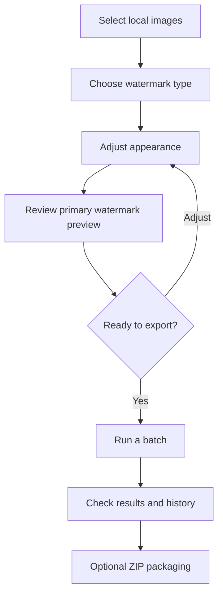

# WatermarkPro — Product walkthrough

[← Back to showcase](README.md) · [Reliability case study](CASE_STUDY.md) · [Testing overview](TESTING.md)

This is a **public-facing overview of user capabilities**, not a technical specification, installation guide, source-code release, or promise of commercial availability.

## The problem the product addresses

Applying watermarks to a handful of images is manageable by hand. Repeating a consistent watermark across a large group becomes harder: users need predictable settings, a chance to check appearance, and confidence that exported files won't unexpectedly replace their originals.

WatermarkPro was developed around those practical concerns.

## A closer look at the interface

All images below are **real WatermarkPro application screenshots**. Private local paths have been permanently covered, and some views are cropped to emphasize the workflow.

### Home — From input queue to processing controls

The Home tab brings image selection, output destinations, watermark options, and batch controls into a single view. The screenshot demonstrates a queued image batch and an example watermark.

### Preview — Check the result before exporting

This preview demonstrates the primary watermark on a sample image, with thumbnail navigation for queued inputs. The preview is for assessing layout before export; additional multi-watermark entries may be applied during output processing.

### Advanced — More than a one-click utility

The Advanced tab provides additional controls for image export, enhancements, automation, performance choices, and watermark customization. Not every option shown is necessarily enabled in this demonstration.

### Settings — Reusable configuration and safer operation

Settings provide configurable appearance, storage location behavior, safety checks, history retention, and profile import/export. Those controls demonstrate why testing state persistence and recoverability mattered during development.

## From images to finished exports

*This is a conceptual user workflow, not a reproduction of the internal application logic.*

### 1. Choose the watermark

Users can work with **text**, **logo/image**, and **QR** watermark types, depending on the purpose of the output. Settings can be adjusted for appearance and positioning.

### 2. Preview before processing

The interface supports previewing the main watermark before export. This is especially useful when experimenting with size or placement.

**Accuracy note:** the preview represents the primary watermark settings; some multi-watermark layouts are applied during final export. A batch result remains the definitive output to review.

### 3. Reuse settings

Reusable settings and templates reduce the need to manually recreate the same choices for every batch.

### 4. Run and review a batch

The application processes selected local images and provides completion information. Cancellation and output checking were important areas of testing, because stopping work should not leave the user uncertain about what completed.

### 5. Manage resulting files

Features developed and tested include output history, optional ZIP creation, and protections intended to preserve selected source images rather than overwrite them unexpectedly. Behavior is evaluated in private release testing; this portfolio is not a universal reliability guarantee.

## Feature groups

| Area | User-facing capabilities |
| --- | --- |
| Watermark creation | Text, logo/image and QR watermark options |
| Preview and consistency | Preview controls; reusable settings and templates |
| Batch operations | Multi-image processing, status reporting, cancellation |
| Output management | History, optional ZIP archives, checks designed to protect selected originals |
| Optional adjustments | Image resize and basic appearance adjustments, where enabled |

## A product-design priority: preserve trust

Several design and validation questions guided the project:

- Can a user tell **what will be applied** before running a batch?
- Can settings be **saved and reused**?
- If processing is interrupted, can the user distinguish **completed, cancelled, and failed** work?
- Are selected source images **protected** while outputs are produced?
- If a problem is fixed, does the normal workflow **still work afterward**?

These questions drove much of the independent testing and troubleshooting work documented elsewhere in this portfolio.

## Where to go next

For a specific investigation with measurable before/after evidence, read the **[reliability case study](CASE_STUDY.md)**. For platform coverage and validation methods, see **[testing and release checks](TESTING.md)**.

> **Availability:** This is a portfolio demonstration of a private software project. There is no executable, installer, source download, or purchase link in this repository. Any future distribution will be announced separately.
