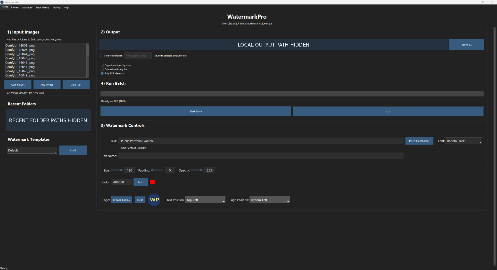
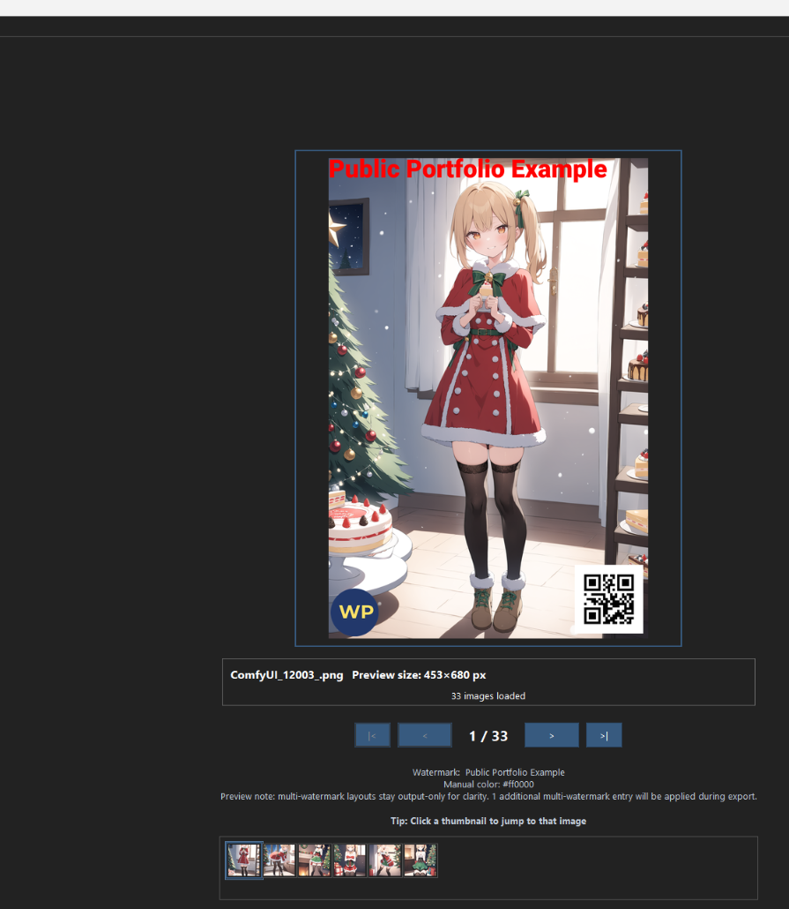
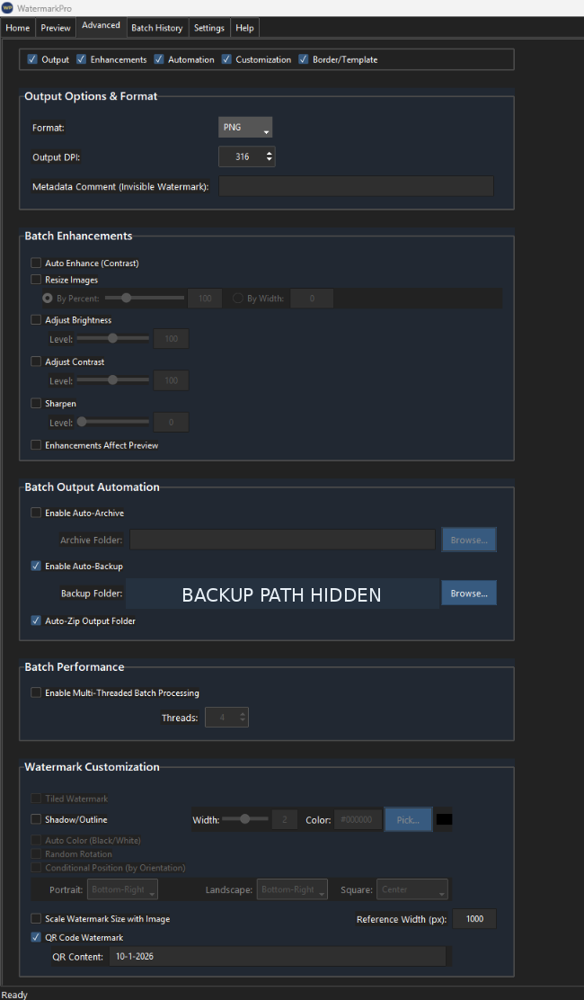
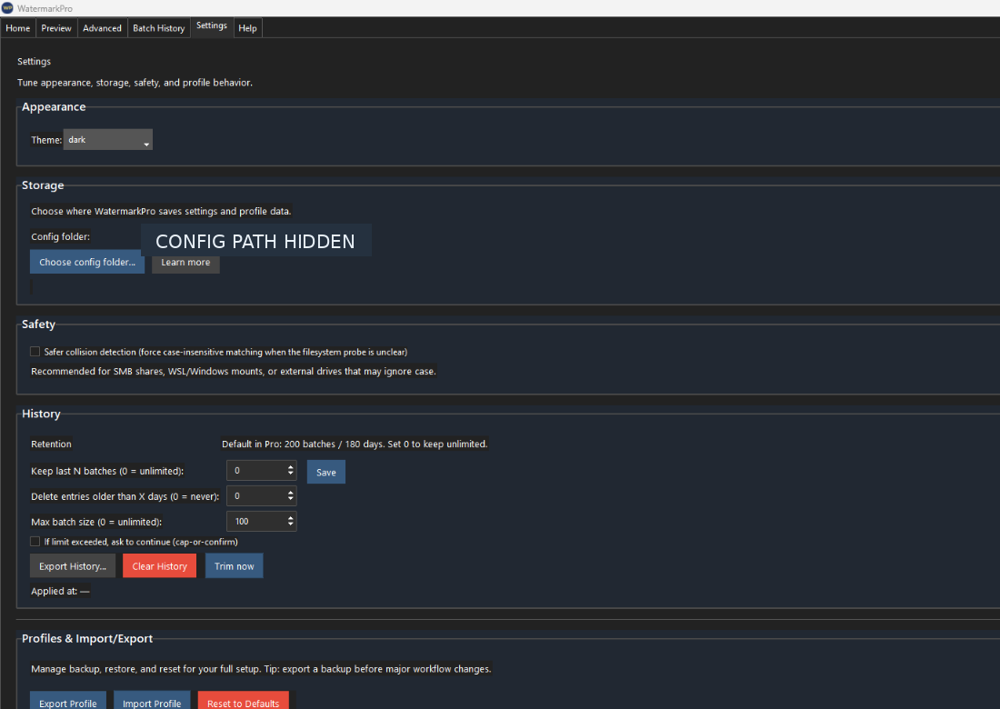

# WatermarkPro | Guided product tour

[← Return to showcase](README.md) · [Reliability case study](CASE_STUDY.md) · [Testing approach](TESTING.md)

WatermarkPro is an **offline desktop tool** for applying watermarks across individual images or batches. This guided tour uses real, redacted screenshots from a private Windows release candidate. It demonstrates the experience, not a publicly available download.

> **What to look for:** A workflow organized around preparation, checking, processing, and reviewing results—along with settings that support repeated use.

## 1. Home — Prepare and run a batch

Click to view the full-size Home screenshot. Local folder locations have been permanently covered.

The Home tab gives the user one place to work through the essential setup.

| Visible area | What it enables |
| --- | --- |
| **Input Images** | Build a queue using individual files or folders |
| **Output** | Choose the destination and output-handling preferences |
| **Watermark Controls** | Enter watermark text; adjust appearance, placement, and logo options |
| **Run Batch** | Start processing and monitor status |

**Why it matters:** A repeatable batch should be configured in a predictable sequence, not require users to jump between unrelated screens.

## 2. Preview — Check before exporting

Example preview shown with demonstration content; image navigation and thumbnails support checking the selected inputs.

The Preview tab helps the user assess the **primary watermark's appearance and placement** before a longer batch. The example contains a text overlay, logo mark, and QR element.

**Important behavior:** The primary watermark is previewed; additional multi-watermark entries may be applied during the final export. Previewing helps catch layout issues, but checking the exported image remains important.

## 3. Advanced — Adjust output behavior

The backup folder path is permanently redacted. Not every setting shown is enabled in the example.

The Advanced tab groups capabilities that users may want to change less frequently:

- **Output formats and image adjustments:** Format choices plus optional resizing and image enhancements.
- **Automation:** Optional backup and archive settings.
- **Customization:** Additional watermark behavior, including QR-related settings.
- **Performance:** Processing-related options for suitable workloads.

**Why it matters:** Keeping optional controls available without making them mandatory supports both simple and more involved workflows.

## 4. Settings — Persistence, safety, and reusable profiles

Local configuration path permanently redacted. This is a real settings screen, not a conceptual mockup.

Settings make the tool usable beyond a single demonstration:

| Area | Purpose |
| --- | --- |
| **Appearance** | Theme preference |
| **Storage and safety** | Where configuration lives, with options related to safer file behavior |
| **History** | Retention and exporting prior batch records |
| **Profiles** | Export and import reusable configurations |

A major part of the project's hands-on testing involved verifying that preferences, templates, and history behaved correctly after closing and reopening the app. The [reliability case study](CASE_STUDY.md) illustrates why persistent settings deserved careful attention.

---

## From setup to verified outputs

*Illustrative user journey, not an internal architecture or source-code diagram.*

WatermarkPro's user-facing design places emphasis on understandable settings, repeatable work, and protecting selected original images. Cancellation outcomes, output handling, and settings persistence were all subjects of private validation.

## What these screenshots prove — and what they don't

They show a **working desktop user interface with distinct features and workflows**. They are not proof of compatibility across every operating system or device, and they do not make the application available for download.

For evidence about specific tests, see **[Testing and release validation](TESTING.md)**. For a measurable troubleshooting example, see **[Reliability case study](CASE_STUDY.md)**.

> **Distribution:** WatermarkPro remains a private, proprietary project with possible future commercial availability. No application source, binary, build process, or internal test data is shared in this portfolio.
