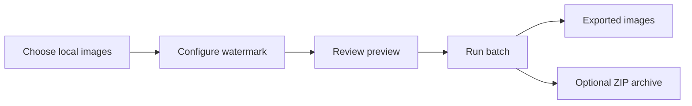

# WatermarkPro

**Offline batch image watermarking · Desktop software portfolio · Windows / Linux evaluation**

> **Portfolio only — not an application download.** This repository contains curated project documentation. It does **not** contain WatermarkPro source code, build scripts, proprietary workflows, installers, executable packages, internal reports, secrets, or customer files. The development repository remains private.

## Project at a glance

WatermarkPro is a desktop application for applying watermarks to images locally, without requiring images to be uploaded to a cloud service. The project combines a usable interface, repeatable batch operations, safety checks, and software-release testing.

| Area | Overview |
| --- | --- |
| Project | Offline desktop watermarking and image-processing workflow |
| Platform | Windows is the primary platform; Ubuntu 22.04/24.04 beta packages have undergone virtual-machine evaluation |
| Features | Text, logo/image, and QR watermarks; preview; batch processing; reusable settings; export history; optional ZIP packaging |
| Technical context | Python-based desktop application, Windows packaging, Git/GitHub, functional and regression testing |
| Distribution | **Private pre-release project. No public downloads in this repository.** |

## Why I worked on it

My goal was to develop a practical desktop workflow that would let users apply consistent watermarks to many images while retaining control over their original files. Beyond features, I focused on repeatability, user-facing reliability, troubleshooting, and testing before distribution.

**My involvement:** requirements and workflow decisions, iterative development with AI-assisted tools, hands-on Windows testing, Ubuntu virtual-machine evaluations, issue reproduction, release-validation checks, and documentation. This is independent project work, not a claim of paid professional IT employment or sole authorship of every line of code.

## User-facing capabilities

- **Preview-first workflow:** adjust watermark appearance before exporting images.
- **Batch processing:** process groups of images using consistent settings.
- **Reusable configurations:** save settings or templates for repeatable use.
- **Multiple watermark types:** text, logo/image, and QR-based marks.
- **Output management:** optional archives, history records, and safeguards designed to avoid overwriting originals.
- **Offline operation:** image processing takes place locally.

### Conceptual workflow

*This diagram illustrates the user workflow, not the internal software architecture.*

## Engineering and problem-solving evidence

### Reliability investigation

During physical Windows testing, I encountered serious delays at startup and during everyday interactions. I compared clean and existing application settings to isolate the problem, then validated the corrective work through repeated tests. A preserved configuration file of roughly **1.5 GB** was reduced to about **117 KB** during repair validation, while meaningful user settings were retained.

Read the [public-safe reliability case study](CASE_STUDY.md).

### Platform and release checks

I used repeated checks covering startup, navigation, settings persistence, batch operation, cancellation, output integrity, help documentation, and installation or reinstallation behavior. Windows physical-device tests were supplemented by Ubuntu virtual-machine evaluations.

Read the [testing and validation overview](TESTING.md).

## Skills demonstrated

| Skill area | Example in this project |
| --- | --- |
| Troubleshooting | Form hypotheses, isolate variables, reproduce issues, verify outcomes |
| Software testing | Run repeatable functional and regression checks across builds |
| Documentation | Record expected behavior, test results, and validation steps |
| Windows support | Investigate application behavior, file handling, settings, and package usability |
| Linux familiarity | Evaluate Ubuntu packages using virtual machines and repeatable checks |
| Customer-focused design | Prioritize understandable settings, preview behavior, and recovery from interrupted work |

## Portfolio media

The project is kept private ahead of a possible commercial release. Public interface screenshots or demonstrations may be added **after a separate privacy and proprietary-information review**. No screenshot or video in this repository is an offer of a free application download.

## Availability and rights

This repository is a **documentation-only portfolio**, not an open-source project. No source-code license or application distribution rights are granted by this page. See [RIGHTS.md](RIGHTS.md).

For professional inquiries, use the [GitHub profile](https://github.com/Roxas130).
