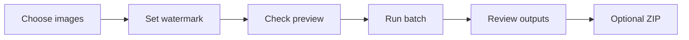

# WatermarkPro

**Offline image watermarking, batch processing, and practical software reliability.**

*Independent desktop application project · Windows-first · Ubuntu beta evaluation*

> **Public portfolio, not a software download.** This showcase contains selected product descriptions and testing evidence. The application source code, internal workflows, installers, executables, private reports, and commercial distribution materials remain private.

**Explore:** [Product walkthrough](PRODUCT_TOUR.md) · [Reliability case study](CASE_STUDY.md) · [Testing evidence](TESTING.md) · [Rights and availability](RIGHTS.md)

---

## The project in 30 seconds

WatermarkPro is a desktop application designed to help people apply consistent watermarks to images **locally**. Rather than being a one-off image-processing script, the project explores a complete workflow: choosing images, setting up a watermark, reviewing a preview, running a batch, and checking the results.

| Product | Technical work | Current availability |
| :--- | :--- | :--- |
| Text, logo/image and QR watermarks; reusable settings; preview and batch export | Python desktop development, troubleshooting, hands-on testing, release validation and documentation | Private pre-release project. **No public app download** in this repository |
| Local file processing, optional ZIP packaging and history | Windows physical-device checks and Ubuntu 22.04/24.04 virtual-machine evaluation | Windows is the primary platform; Linux testing is **not** a claim of a supported public release |

## A typical user journey

*User-facing workflow, not a diagram of the application's internal implementation.*

| Step | What matters to the user |
| --- | --- |
| **Prepare** | Work with local image files and choose text, logo/image, or QR watermarks |
| **Preview** | Review the primary watermark's appearance before running a batch |
| **Repeat** | Reuse settings or templates to apply consistent choices across images |
| **Export** | Process a batch, check output files, and optionally package them into a ZIP |
| **Recover** | See meaningful progress, cancellation results, and history rather than guessing what happened |

**[See the more detailed product walkthrough →](PRODUCT_TOUR.md)**

## The technical story behind the product

<strong>1. Troubleshooting a severe slowdown</strong>

During physical Windows testing, ordinary actions that were previously responsive began taking roughly a minute. Instead of attributing the slowdown to antivirus activity or packaging, I compared controlled conditions, isolated persisted application state, and helped validate the repair.

| Evidence point | Result |
| --- | --- |
| Problem | Long startup, file interaction and shutdown delays during private testing |
| Affected configuration | Approximately **1.5 GB** |
| Preserved configuration after repair validation | Approximately **117 KB** |
| User-impact check | Responsive behavior returned; important settings and original images were retained during verification |

[Read the reliability investigation and verification steps](CASE_STUDY.md).

<strong>2. Testing across Windows and Ubuntu</strong>

The project has involved hands-on Windows tests and repeatable Ubuntu 22.04/24.04 virtual-machine evaluations. Checks cover launching, previewing, batch processing, cancellation, settings persistence, output integrity, interface readability, and package behavior. This is project-level validation, **not third-party certification** or a guarantee of compatibility across all hardware.

[Explore the test matrix and example results](TESTING.md).

## My contribution

I have been involved in **requirements and workflow decisions, iterative AI-assisted development, hands-on Windows testing, Ubuntu virtual-machine evaluations, investigating reproducible problems, reviewing fixes, release-validation checks, and documentation**.

I use AI-assisted development tools as part of the implementation process. The accomplishments highlighted here describe my project involvement and testing work; they do **not** claim professional IT employment or sole authorship of every line of code.

### Skills this project helps demonstrate

| Skill | Evidence in WatermarkPro |
| --- | --- |
| **Systematic troubleshooting** | Comparing clean and affected settings to isolate a performance problem |
| **Functional and regression testing** | Checking workflows before and after changes, including cancellation and file safety |
| **Desktop and OS support** | Investigating Windows application behavior and evaluating Ubuntu packages in VMs |
| **Documentation** | Keeping repeatable checks, expected outcomes, and observed results |
| **User-centered thinking** | Paying attention to previews, preserved originals, meaningful status information, and recoverability |
| **Release readiness** | Verifying that packaged applications launch, run workflows, and can be reopened or reinstalled |

## Technical context

**Python desktop application** · **Tk-based interface** · **image-processing libraries** · **Git/GitHub** · **Windows packaging** · **Ubuntu virtual machines** · **manual and automated validation**

This section deliberately stays at a high level; the showcase is about product behavior and engineering process, not source-code disclosure.

## About this public repository

**Included:** documentation, a sanitized technical case study, a testing overview, and distribution boundaries.

**Not included:** source code, application downloads, installer packages, private Git history, internal CI/build instructions, proprietary implementation details, credentials, or customer data.

WatermarkPro is a **proprietary, privately developed project** with potential future commercial distribution. Nothing here represents a free or open-source release. See [RIGHTS.md](RIGHTS.md).

**Professional contact:** [GitHub profile](https://github.com/Roxas130).

*Interface screenshots and a short walkthrough can be added once each image has been reviewed for private paths, accounts, release details, and unreleased features.*
