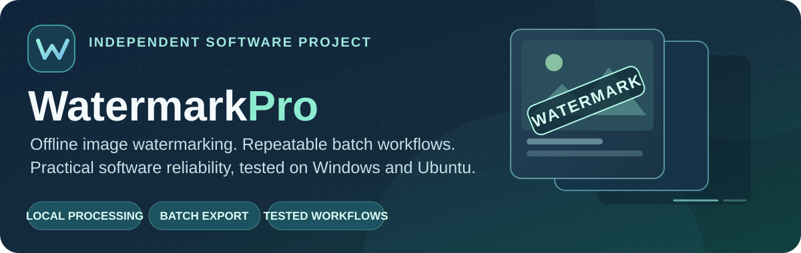
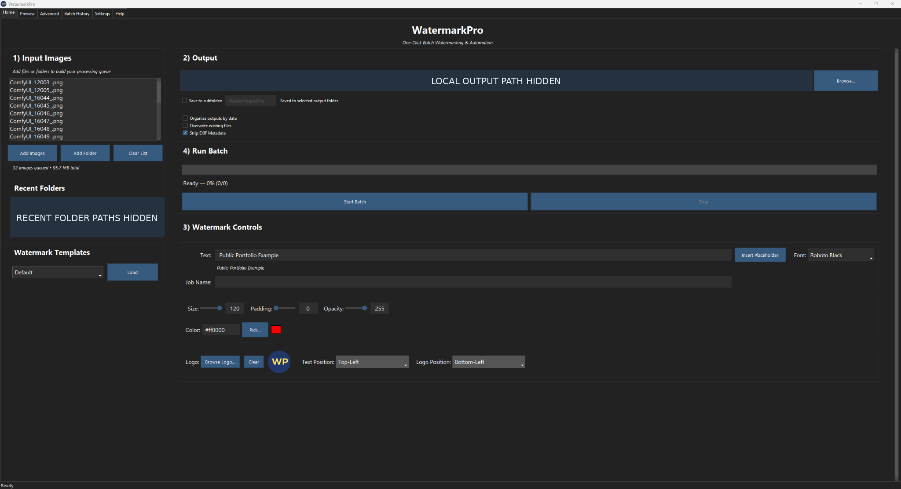
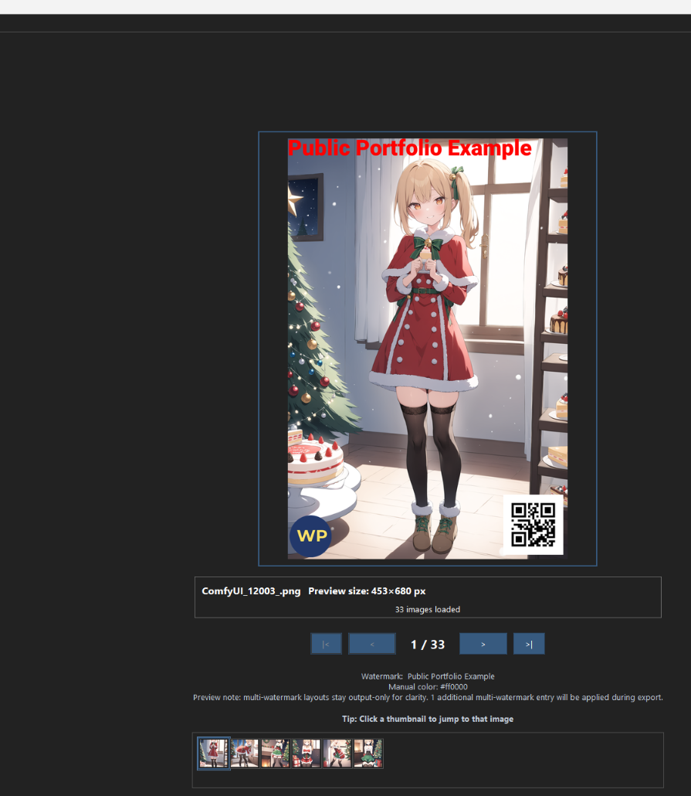
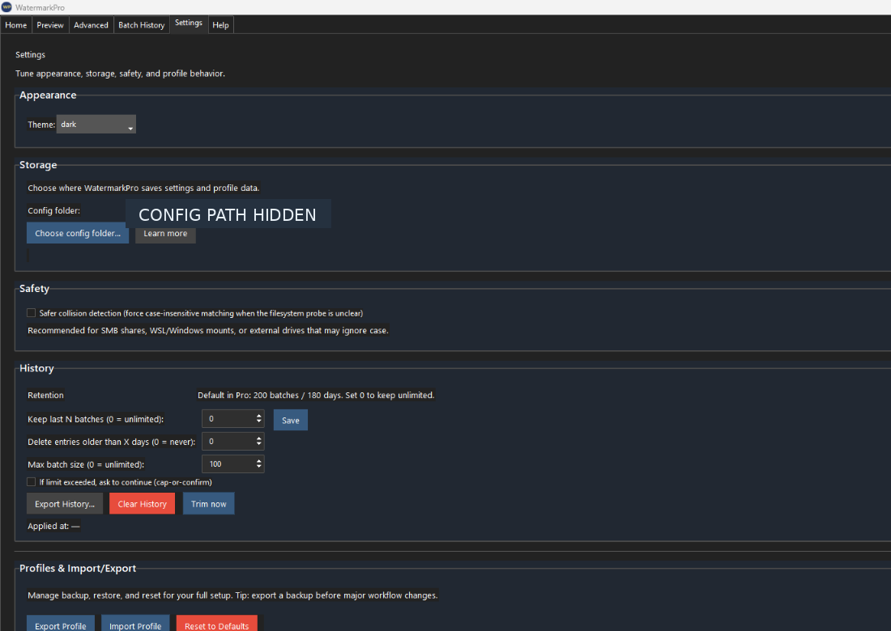
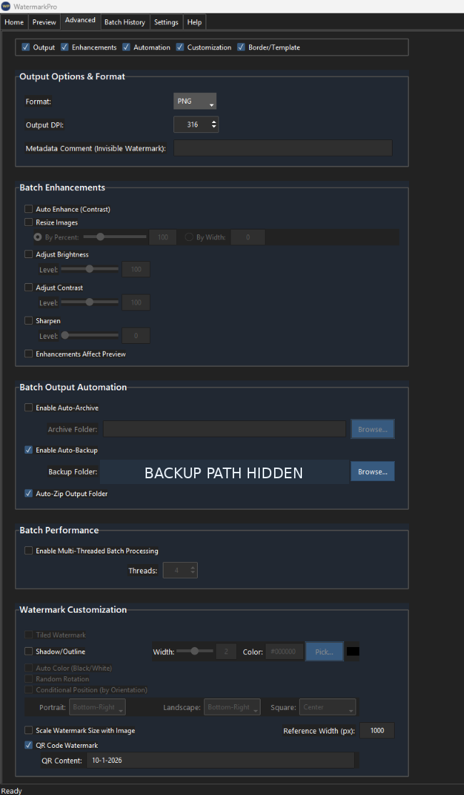

# WatermarkPro
**Offline image watermarking • Preview-first workflow • Repeatable batch processing**

An independent desktop software project focused on making image watermarking more consistent, understandable, and reliable. Built for local processing, with hands-on Windows testing and Ubuntu virtual-machine evaluations.

> **Portfolio showcase — not an application download.** WatermarkPro is a proprietary, private pre-release project. This repository contains selected screenshots, a product walkthrough, and evidence of testing and troubleshooting—not source code, executables, installers, or internal development materials.

[**View the product tour**](PRODUCT_TOUR.md) · [**Explore the reliability case study**](CASE_STUDY.md) · [**Review testing evidence**](TESTING.md) · [**Rights & availability**](RIGHTS.md)

---

## See the actual application

**One workspace for configuring and running batches.**

**Home —** Add images, select where results go, configure watermark settings, and run a batch. Click the image for the full-size screenshot.

**Preview your watermark before committing to a batch.**

**Preview —** A sample image demonstrates the primary watermark layout. Some multi-watermark entries are applied during export; final output should be checked after processing.

<strong>See more of the interface: Settings and Advanced controls</strong>

 

**Settings —** Configure storage, appearance, history retention, safety behavior, and profile import/export.

  

**Advanced —** Output formats, optional image adjustments, automation, performance, and watermark customization.

*Every screenshot here comes from WatermarkPro, not a generated mockup. Private local paths are covered in the published image files. The banner is illustrative artwork.*

**[Walk through all four tabs with explanations →](PRODUCT_TOUR.md)**

---

## The product in a nutshell

| **Prepare** | **Preview** | **Process** | **Review** |
| :--- | :--- | :--- | :--- |
| Select local images and choose text, logo/image, or QR watermark options | Adjust appearance and inspect the primary watermark | Process groups of images with reusable settings | Check results, history, and optional ZIP exports |

The product is designed around a practical question: **How can someone watermark many images without repeatedly recreating settings or risking their originals?**

### Three examples of real validation work

| **Performance investigation** | **Cancellation test** | **Cross-platform evaluation** |
| :--- | :--- | :--- |
| **~1.5 GB → ~117 KB** | **33 images** | **2 Ubuntu LTS versions** |
| Size of a preserved affected settings file before and after a specific repair-validation run | In one Windows test: **4 completed, 29 cancelled, 0 failed** | Ubuntu **22.04** and **24.04** beta evaluations in virtual machines |
| [Investigation and verification](CASE_STUDY.md) | [Test method and context](TESTING.md) | [Platform coverage and limits](TESTING.md) |

*These are selected internal test observations—not generalized benchmarks, independent certification, or a guarantee across all computers.*

## A troubleshooting example

During Windows testing, WatermarkPro became unexpectedly slow. The installed and portable versions exhibited similar behavior; everyday operations that had been responsive began taking about a minute.

I investigated competing explanations, compared clean and affected application settings, worked through the corrective process with AI-assisted tools, and verified the outcome through repeated workflow checks. A preserved affected settings file was compacted from roughly **1.5 GB to 117 KB**, while important settings and selected source images were preserved in validation.

**[Read the investigation, evidence, and lessons learned →](CASE_STUDY.md)**

## What I contributed

This is **independent project work**, not paid professional IT employment or a claim that I personally authored every line of code.

- **Workflow and requirements:** Defined user-facing goals, settings behavior, and practical acceptance criteria.
- **Testing:** Performed Windows checks covering launch, image preview, batch processing, cancellation, persistence, and file safety.
- **Troubleshooting:** Reproduced issues, compared variables, evaluated changes, and checked for regressions.
- **Linux evaluation:** Tested Ubuntu 22.04/24.04 beta packages inside virtual machines, including usability and packaging behavior.
- **Release readiness:** Reviewed build behavior, installation/reinstallation checks, and supporting documentation.
- **AI-assisted development:** Used AI tools in the implementation process while performing hands-on project evaluation and validation.

**Skills demonstrated:** Windows troubleshooting · Python desktop application context · Software testing and QA · Git/GitHub · Ubuntu VMs · Technical documentation · Release verification

## Project status

| Platform / access | Current scope |
| --- | --- |
| **Windows** | Primary platform for private physical-device testing |
| **Ubuntu** | 22.04/24.04 beta packages evaluated in VMs; no public support claim |
| **macOS** | Not supported |
| **Download / purchase** | Not offered through this portfolio; possible future commercial distribution is separate |
| **Source access** | Proprietary and private; see [rights notice](RIGHTS.md) |

**For professional inquiries:** [GitHub profile](https://github.com/Roxas130).

All screenshots are demonstrations of the private application. No source code, application packages, or internal build instructions are provided by this repository.
