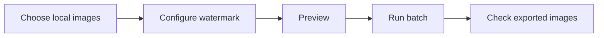

Original portfolio illustration; not a screenshot of the application's interface.

# WatermarkPro

**An offline desktop application for applying consistent image watermarks, with a focus on dependable batch workflows and real-world testing.**

*Independent software project · Windows primary platform · Ubuntu 22.04/24.04 beta evaluation*

> [!NOTE]
> **Portfolio only — not an application download.** This public repository documents the project and selected evidence of my work. The proprietary application source, development history, installers, executable files, and internal release materials remain private.

### Explore the project

| **See what it does** | **See how I solved problems** | **See what I tested** |
| :--- | :--- | :--- |
| [Product walkthrough →](PRODUCT_TOUR.md) | [Reliability case study →](CASE_STUDY.md) | [Testing and validation →](TESTING.md) |
| Watermarks, preview, batch export, reusable settings | Diagnosing an unexpected performance problem | Windows checks, Ubuntu VM evaluation, cancellation and file-safety checks |

---

## See the application

These are **actual WatermarkPro screenshots**, cropped and permanently redacted to conceal private local file paths. They are not mockups. The opening banner above is an illustration, not an application screenshot.

<table>
<tr>
<td width="60%" valign="top">
  
   <strong>Main workflow</strong> — Queue inputs, configure a watermark, choose outputs, and manage the batch.
</td>
<td width="40%" valign="top">
  
   <strong>Preview</strong> — Inspect a sample image with a watermark before export.
</td>
</tr>
</table>

<strong>Settings and safety:</strong> configurable appearance, storage controls, history retention, and profile import/export. The [full product tour](PRODUCT_TOUR.md) also shows the Advanced tab.

## At a glance: three pieces of evidence

| **~1.5 GB → ~117 KB** | **33-image cancellation test** | **2 Ubuntu LTS versions** |
| :--- | :--- | :--- |
| Preserved settings file size before and after a specific repair validation | 4 completed · 29 cancelled · 0 failed in one documented Windows test | Evaluations of Ubuntu **22.04** and **24.04** beta packages in virtual machines |

*These are examples from specific private tests, not universal performance claims or third-party certification. [How the evidence was collected](TESTING.md).*

## What WatermarkPro does

Watermarking many images should not require repeating the same choices over and over. WatermarkPro brings these tasks together in a local desktop workflow:

| **Create** | **Preview** | **Process & review** |
| :--- | :--- | :--- |
| Work with text, logo/image and QR watermarks | Adjust appearance and inspect the main watermark before export | Run batches, check outputs, save reusable settings, and optionally create ZIP archives |

*Conceptual user journey—not the internal program architecture. The preview shows the primary watermark; some multi-watermark layouts are applied during final export.*

**[Explore the product step by step →](PRODUCT_TOUR.md)**

## The problem I learned the most from

One private Windows release candidate became very slow: ordinary actions and shutdown took roughly a minute, even though the app had previously been responsive.

Instead of assuming the issue was Windows Defender or the installation format, I compared clean settings with the existing persisted state and worked through the corrective process using AI-assisted development tools. Repeated tests verified improved responsiveness and checked that existing user settings and selected original images were preserved.

| Investigation | Measurable validation |
| :--- | :--- |
| Isolate the condition that changes performance | An affected configuration of about **1.5 GB** was reduced to about **117 KB** during preservation testing |
| Check the repair rather than assuming success | Startup and ordinary interaction became responsive in the tested workflows; settings and outputs were checked again |

**[Read the troubleshooting story and evidence →](CASE_STUDY.md)**

## What I personally contributed

This is **independent project experience**, not a claim of paid IT employment.

- **Requirements and usability:** established workflow goals and reviewed user-facing behavior.
- **Hands-on testing:** ran Windows tests for launch, previews, batches, cancellation, settings persistence, and outputs.
- **Cross-platform evaluation:** tested Ubuntu packages in virtual machines, including layout, readability, and normal operation.
- **Troubleshooting:** reproduced issues, compared conditions, examined outcomes, and checked corrective work.
- **Release validation and documentation:** maintained repeatable checks and evaluated package behavior.
- **AI-assisted development:** used AI tools in the implementation process; I do not claim sole authorship of every line of source code.

### Skills demonstrated

**Windows troubleshooting** · **Python desktop application context** · **Git/GitHub** · **Software QA** · **Regression testing** · **Ubuntu virtual machines** · **Technical documentation** · **Release verification**

For employers, the value of this project is not only the app itself—it is the evidence of **systematic testing, investigating failures, protecting user files, and validating fixes**.

## Project status and privacy

| Area | Status |
| --- | --- |
| **Windows** | Primary development and physical testing platform |
| **Ubuntu** | 22.04/24.04 beta packages evaluated in VMs; public support is not claimed |
| **macOS** | Not supported |
| **Availability** | Private pre-release project; **no software downloads or sales link** in this portfolio |
| **Source and rights** | Proprietary; [read the rights notice](RIGHTS.md) |

**Portfolio media:** The gallery above uses selected, redacted screenshots of the private application. Images are for demonstration only and do not constitute a public app release. The banner is original illustrative artwork, not a screenshot.

**Contact for professional inquiries:** [GitHub profile](https://github.com/Roxas130).

WatermarkPro is a proprietary project. This public documentation does not grant rights to the application or its source code. See [RIGHTS.md](RIGHTS.md).
