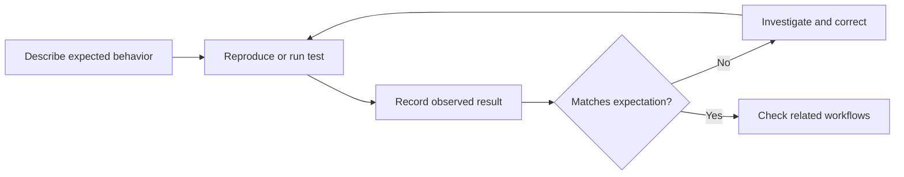

# Testing and release validation — WatermarkPro

[← Back to showcase](README.md) · [Product walkthrough](PRODUCT_TOUR.md) · [Reliability case study](CASE_STUDY.md)

WatermarkPro has been evaluated through **hands-on tests, repeatable troubleshooting checks, and private automated validation**. This page describes selected categories and representative observations without exposing internal release materials.

**Important boundary:** These are project testing records—not an independent certification, a promise of zero defects, or proof that the application works on every computer.

## Platform coverage

| Environment | Kind of evidence | Examples of what was exercised | Important limitation |
| --- | --- | --- | --- |
| **Windows desktop** | Physical-computer acceptance checks | Launch, navigation, watermark preview, batch output, cancellation, settings persistence, ZIP creation, installer/portable use, reinstall/uninstall | Tests cover the configurations checked, not all Windows systems |
| **Ubuntu 22.04 LTS** | Virtual-machine evaluations | App launch, image/batch workflow, cancellation, readable controls, light/dark settings, window resizing, persistence | VM success is not the same as broad physical Linux compatibility |
| **Ubuntu 24.04 LTS** | Virtual-machine evaluations | Preview and export workflows, ZIP output, settings/history, documentation and display/scroll behavior | Beta evaluation only; no publicly supported Linux release is claimed |
| **macOS** | No release qualification claimed | — | Not a supported platform |

## Functional checklist

| Area | What a passing check is intended to establish |
| --- | --- |
| Startup | The packaged application opens and its main controls are usable |
| Preview | Image selection and primary watermark preview work as expected |
| Batch processing | Outputs are generated and can be opened |
| Original-file safety | The chosen source images are not unintentionally overwritten |
| Cancellation | Counts for completed, cancelled and failed work remain understandable |
| Preferences | Saved settings and templates survive closing and reopening |
| ZIP packaging | Optional archive is generated and its contents can be opened |
| UI accessibility | Settings, actions and text remain reachable at tested window sizes and display scales |
| Installer lifecycle | Installed/portable packages launch and the tested uninstall/reinstall paths behave as expected |
| Recovery and regression | An interrupted or repaired workflow is retested to check for unexpected side effects |

## One representative stop/cancel check

During a documented Windows cancellation exercise with **33 selected images**:

| Outcome | Count |
| --- | ---: |
| Completed | **4** |
| Cancelled | **29** |
| Failed | **0** |

This is **one example from a particular test**, not a generalized throughput or reliability statistic. The important point was to check whether partial work was clearly accounted for instead of being silently lost or mislabeled.

## How I evaluated fixes

My records and discussions focused on:

1. **Expected behavior:** what a user should see.
2. **Reproduction:** how to trigger the issue or repeat the workflow.
3. **Observed behavior:** what actually happened and whether it differed.
4. **Change and recheck:** retesting after corrective work.
5. **Regression:** confirming unrelated features and important data remained intact.

For an example of this approach leading to a measurable improvement, see the [slowdown investigation](CASE_STUDY.md).

## Validation is not the same as commercial release

The Windows application and evaluated Ubuntu packages remain part of a **private software project**. This repository contains no application files, sources, internal CI configuration, proprietary test data, credentials, or installation instructions. Any future public software distribution would require separate release decisions and terms.
